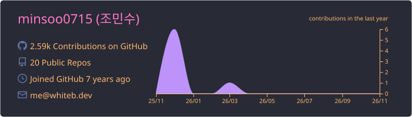
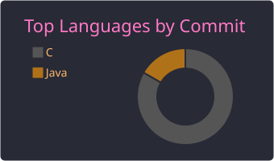
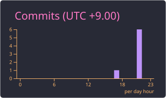

<!--
**minsoo0715/minsoo0715** is a ✨ _special_ ✨ repository because its `README.md` (this file) appears on your GitHub profile.
!-->

<!--
Here are some ideas to get you started:

- 🔭 I’m currently working on ...
- 👯 I’m looking to collaborate on ...
- 🤔 I’m looking for help with ...
- 💬 Ask me about ...
- 📫 How to reach me: ...
- 😄 Pronouns: ...
- ⚡ Fun fact: ...
-->

### Introduction

- 조민수
  - 한양대학교 ERICA 전자공학부, 컴퓨터학부 전공
  - 한국디지털미디어고등학교 18기 웹프로그래밍과
  - 🌱 Java/Spring Boot를 학습중입니다.
  - 💻 웹, 특히 백엔드 분야에 관심을 가지고 공부중입니다.
  - 🔭 NGINX, Docker, AWS 등 SE/CE 관련 기술에 대해서도 관심을 가지고 공부중입니다.
  - ⚡ 소프트웨어의 기반이 되는 하드웨어에도 관심이 있습니다.
  - 📝 [블로그](https://blog.naver.com/minsoo0715)에 주로 다양한 문제를 해결한 경험을 공유하고 있습니다.
  

